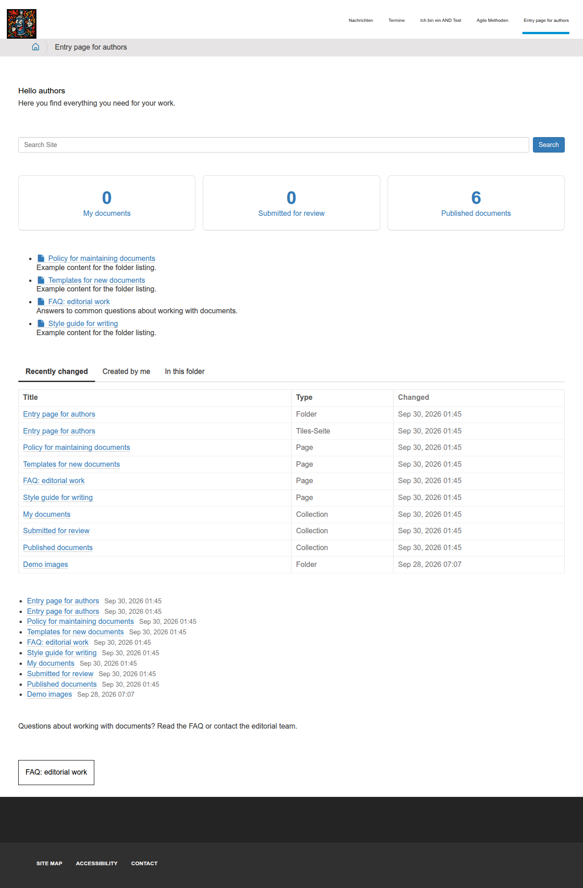

# Entry pages with placeholder tiles

Version 1.10 (22.10.2026), changes in [CHANGELOG.md](CHANGELOG.md)

Result of the evaluation "Entry pages with editorial tiles and programmed areas".
The five packages live on `main` (Plone 5.2) and on `21170-migrate_to_plone6` (Plone 6) with identical code.
They run unchanged on Plone 5.2.2 and Plone 6.1.2.

Feedback and open questions live outside the repository with the client.
This folder only holds what stays stable.
Every change to the tiles or to this documentation raises the version and gets an entry in [CHANGELOG.md](CHANGELOG.md).

| File | Content |
|---|---|
| [evaluation.md](evaluation.md) | Recommendation, answers to the questions of the assignment, findings, limits, follow-up tasks |
| [interfaces.md](interfaces.md) | The five interfaces through which a project adapts the tiles, with contract tests |
| [adoption.md](adoption.md) | Adopting the tiles in your project: check requirements and assets, add the packages, tile without styling |
| [CHANGELOG.md](CHANGELOG.md) | What changed from version to version |

## Result

- Folder listing, search and dashboard (numbers loaded by JavaScript) run as ordinary tiles on a tiles page.
  This is variant A of the assignment, the tiles editor needed no special treatment.
- Two more tiles serve projects whose areas are further away from the Plone standard:
  "Tab lists" shows several lists in tabs, "Embedded view" embeds a registered view.
- Editors can only place and move the tiles.
  In the editor they see grey placeholders.
  The only exception is the view tile, where editors pick the view from a list.
- What a tile shows comes from an adapter.
  A project replaces the adapter and touches neither views nor templates.



## Where things live

| Path | Content |
|---|---|
| [`src/graffiti.tile_listing`](../../../src/graffiti.tile_listing/README.md) | Tile "Folder listing" |
| [`src/graffiti.tile_search`](../../../src/graffiti.tile_search/README.md) | Tile "Search" with live results |
| [`src/graffiti.tile_dashboard`](../../../src/graffiti.tile_dashboard/README.md) | Tile "Dashboard" |
| [`src/graffiti.tile_tabs`](../../../src/graffiti.tile_tabs/README.md) | Tile "Tab lists" |
| [`src/graffiti.tile_view`](../../../src/graffiti.tile_view/README.md) | Tile "Embedded view" |
| [`src/graffiti.tile_button`](../../../src/graffiti.tile_button/README.md) | Custom CSS classes for the button tile, for example for a button that opens a dialog of the project |
| `scripts/setup_demo_entry_page.py` | Creates the demo page "Entry page for authors" |
| `scripts/check_tiles_requirements.py`, `scripts/check_tiles_assets.py` | Check scripts for the adoption, see [adoption.md](adoption.md) |

## Try it

You need a Plone site with `graffiti.policy` installed and a user `admin` in the Zope root.
Use `main` for Plone 5.2 or `21170-migrate_to_plone6` for Plone 6.

```shell
git checkout main
bin/buildout
bin/instance run scripts/setup_demo_entry_page.py <site_id>
bin/instance fg
```

The script installs the five packages in the site, deletes `/entry-authors` and creates it again.
Without an argument the site id is `site`.

Then compare `http://localhost:15001/<site_id>/entry-authors` as a visitor and logged in: the numbers of the boxes, the folder listing and the tab "Created by me" differ.
The editor is at `/entry-authors/entry/@@edit`.
Opening the editor creates a working copy, running the script again resets the page.
In the editor the view tile has a gear icon that opens the choice of the view (example: sitemap of Plone).

Tests:

```shell
bin/test -s graffiti.tile_listing -s graffiti.tile_search -s graffiti.tile_dashboard -s graffiti.tile_tabs -s graffiti.tile_view
```
