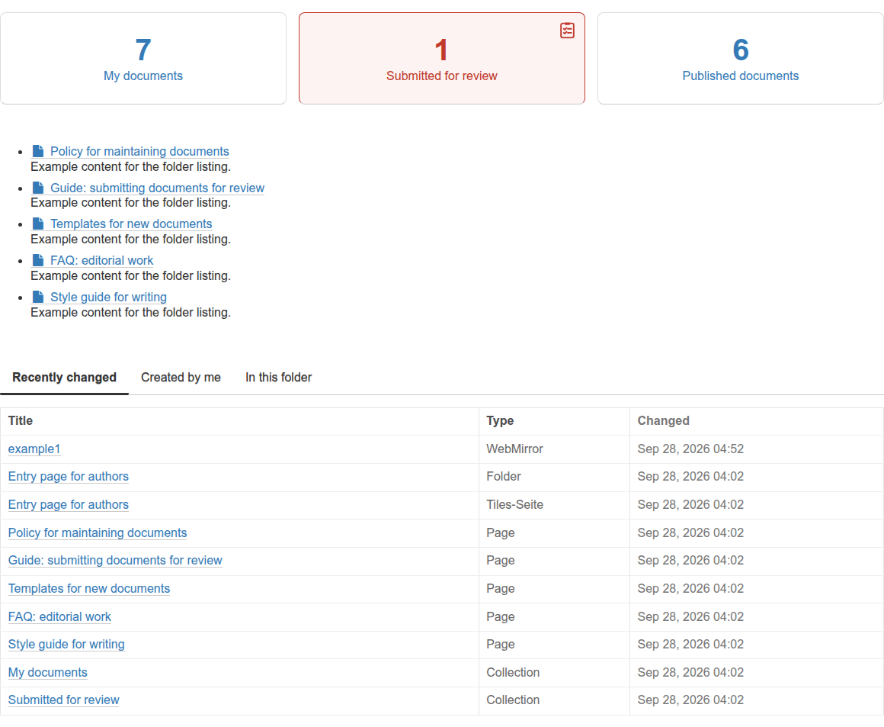
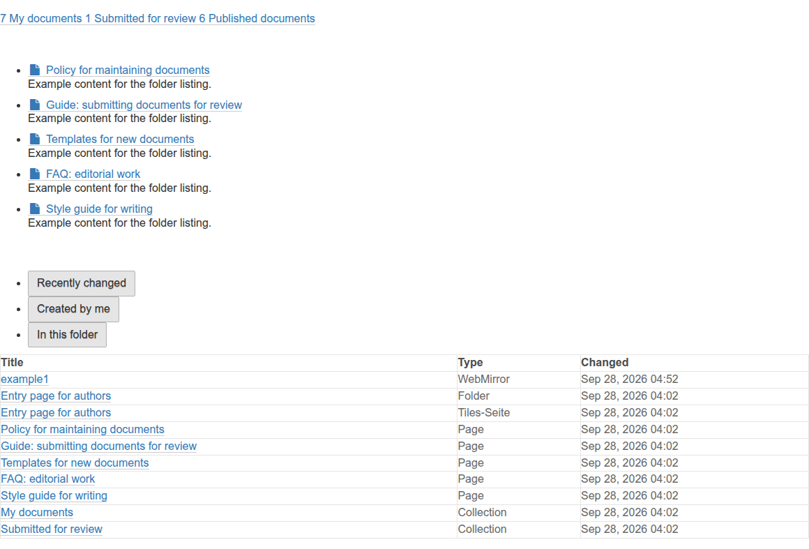

# Adopting the tiles in your project

Version 1.10 (22.10.2026), changes in [CHANGELOG.md](CHANGELOG.md)

This page walks you through adopting the five placeholder tiles in another Plone project: check the requirements, add the packages, check the assets, common errors.
What the tiles show is up to your own adapters afterwards, see [interfaces.md](interfaces.md).

## Check the requirements

From `interaktiv.basetiles` the tiles only need the base classes, the four behaviors, the installation functions and five views, plus a form helper from `interaktiv.framework`.
Whether your project provides all of that is checked by a script that does not need the tile packages themselves:

```shell
bin/zopepy scripts/check_tiles_requirements.py                    # imports and methods, without a database
bin/instance run scripts/check_tiles_requirements.py <site_id>    # plus views, portal types, tiles registered in the editor
```

It prints `ok` or `FEHLT` (missing) per check, names the versions of Plone, `interaktiv.basetiles` and `interaktiv.framework`, and exits with code 1 as soon as something required is missing.

| Check | Required |
|---|---|
| Imports from `interaktiv.basetiles`: `base_functions`, `stubs`, `configs.animations`, `contenttypes`, `contenttypes.basetile`, `contenttypes.tilepage`, `views.basetile`, the four behaviors | yes |
| `interaktiv.framework.form` with `handle_required_fields`, `plone.subrequest`, `lxml.html` | yes |
| Members of `BaseTileView` and `TilePage` that the tiles call | yes |
| With a site: portal types `TilePage` and `TileRowCT` | yes |
| With a site: views `@@tile_view`, `@@tile_edit`, `@@background_options`, `@@update_content`, `@@configure_tile_modal` for `ITilePage` | yes |
| `interaktiv.basetiles.test`, `interaktiv.framework.TestLayer`, `interaktiv.framework.test.TestCase` | no, only for the tests of the packages |
| With a site: tiles registered in the editor, frame tile | no, for orientation only |

One check remains manual in the browser: on a tiles page `ModalClass`, `refreshTiles` and `jQuery` must exist (console: `typeof refreshTiles`).

## Add the packages

1. Put the five packages as checkouts under `src/`, for example with mr.developer.
   Only there Grunt finds their LESS and JavaScript files, an egg is not enough.
2. Add them to `eggs` and `develop` of the buildout and run `bin/buildout`.
   The buildout merges the package list in the root `package.json` and builds CSS and JavaScript, see [../project/assets-and-styleguide.md](../../project/assets-and-styleguide.md).
3. Install the packages in the site (site setup, add-ons) or add them to the installation package of your project.
4. Register your own adapters for the browser layer of your project, see [interfaces.md](interfaces.md).

## Check the assets

Whether CSS and JavaScript of the tiles are built, complete and up to date is checked by a second script.
It is plain Python and needs no Zope:

```shell
python3 scripts/check_tiles_assets.py                 # in the buildout directory
python3 scripts/check_tiles_assets.py /path/to/buildout
```

| Check | Meaning of `FEHLT` (missing) |
|---|---|
| LESS sources of the five packages under `src/` | Package is not a checkout, Grunt finds no LESS |
| `package.json` in the root and the five packages under `interaktiv_setup.packages` | Merging the package list did not run |
| `node_modules/grunt-cli/bin/grunt` | `npm install` did not run |
| `var/_styleguide.less` | The styleguide step did not run |
| `var/static/css/style.css` and `var/static/js/script.js` exist | Grunt never ran |
| Both files contain the markers of the five tiles | Old build |
| Both files are newer than the sources of the packages | Grunt did not run since the last change |

Fix the first check marked `FEHLT`, start the build again (`bin/update_styleguide` on Plone 5, `bin/buildout install styleguide` on Plone 6) and repeat the check.

## A tile shows up without styling

This is what it looks like when the built `style.css` does not contain the rules of the tiles: the dashboard boxes become a line of links, the tabs become a bullet list, the table loses its spacing.
The tiles themselves work, only their styling is missing.





The most common cause is a server without internet access, where the build stops before Grunt.
The second most common: the packages are installed as eggs instead of checkouts under `src/`.
The script from the section "Check the assets" names the first missing link.
The manual check and the ways for environments without internet access are described in [../project/assets-and-styleguide.md](../../project/assets-and-styleguide.md).
