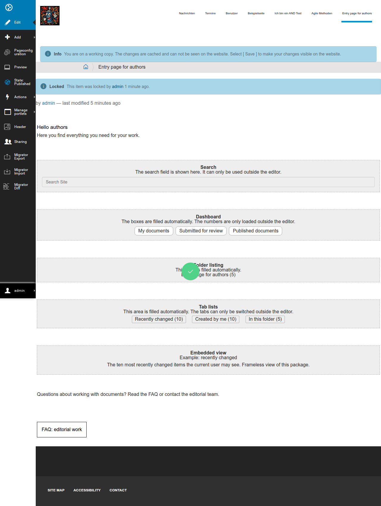
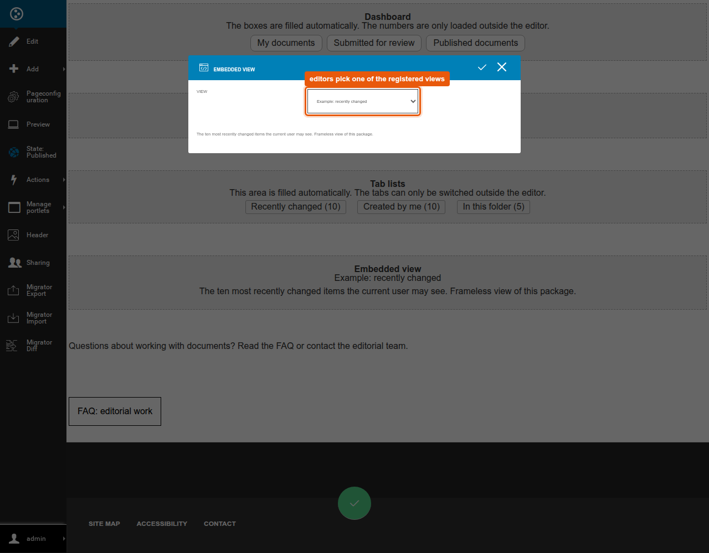
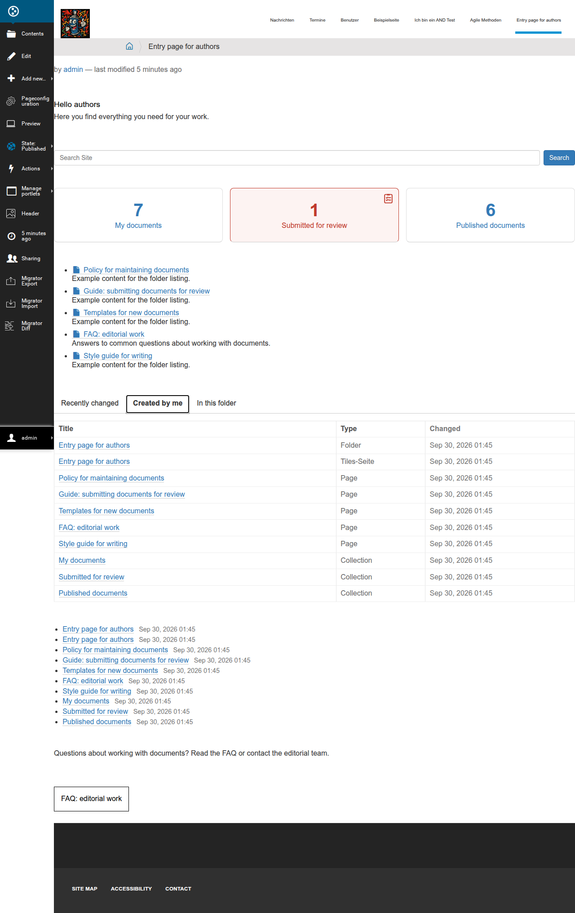

# Evaluation result

Version 1.10 (22.10.2026), changes in [CHANGELOG.md](CHANGELOG.md)

## Recommendation

Implement variant A: the entry page is an ordinary tiles page, every programmed area is its own placeholder tile.

- All three areas could be built with the existing means of the tiles editor.
  The pattern already exists there: `interaktiv.tile_forms` embeds an EasyForm.
- Editors arrange freely.
- An error in one area does not take the page down, the tiles page shows a replacement tile in its place.

Limitation: the check was made with newly built, simple areas, not with an existing, grown view.

## What was built

| Tile | Shows | Technique |
|---|---|---|
| Folder listing | Content of the folder of the page | Catalog query, rendered server side |
| Search | Search field with live results | Plone's `pat-livesearch`, `@@ajax-search`, `@@search`, no own JavaScript |
| Dashboard | Boxes with a number and a link, urgent boxes turn red | Boxes server side, numbers by JavaScript from `@@tile_dashboard_data` |
| Tab lists | Several lists in tabs | Tables server side, tabs switched by a small script |
| Embedded view | A registered view of the project | `plone.subrequest`, frameless view or content area of an ordinary page (`ajax_load`) |

Tab lists and embedded view were added on 23.09. after it became clear that dashboard boxes, collections and search are custom implementations in the target project.
Both are offers, not requirements: tab lists for areas that are built anew, the view tile for areas that already exist as a view.

No tile has a field that editors fill in.
The only exception is the view tile: editors pick from a list that the developer has registered.
The data comes from an adapter, see [interfaces.md](interfaces.md).

## Answers to the questions of the assignment

| Question | Answer |
|---|---|
| Do layout and CSS stay correct inside the tile? | Yes. Styles hang on the tile class (`.tile-search` and so on). One correction was needed: `pat-livesearch` appends the result list after the form and aligns it to the right, inside the tile it belongs below the field. |
| Does the JavaScript keep working? | Yes. `pat-livesearch` initializes itself. `jsinit` from `BaseTileView` is only called in the editor and for lazily loaded rows, not on an ordinary page view. That is why the dashboard also starts itself on `document.ready`. |
| How do parameters reach the area? | Through an adapter on (tiles page, request). It knows the location of the page, the user, their roles and groups. Configurable fields on a tile need a settings dialog per tile, the view tile shows how with its selection. |
| What does a placeholder look like in the editor? | A grey box with name, explanation and preview, technically `template_edit_mode`. A dashboard without boxes is invisible for visitors. |
| Does it fit the tiles styleguide? | Not checked. The tiles use few own rules with fixed grey values. |

## Findings

- **Portlet columns break the layout of tiles pages.**
  As soon as the folder has subpages, the page inherits the navigation portlet.
  The column was squeezed to 46 pixels and pushed the content 160 pixels to the right.
  This affects every tiles page in a folder with content.
  The demo page has the portlets switched off, a fixed rule in the theme or on creation is needed.
- **Embedding existing pages works, but only as an interim solution.**
  The view tile cuts the content area out of an ordinary page with `ajax_load=1`.
  Plone's sitemap (plain HTML) sits cleanly in the tile.
  Plone's search page, however, shows its filter menus unfolded because the Bootstrap CSS of the page frame is missing in the tiles theme, and a JavaScript search brings its script as its own `<script>`.
  Areas that are meant to stay belong in a frameless view (mode `view`).
- **The search parameter is configurable.**
  A custom search page that does not expect the term as `SearchableText` gets its name through the adapter.
- **The folder listing hides what is excluded from navigation.**
  That way editors control what appears without code.
- **Plone 5.2 and Plone 6 hardly differ for the tiles.**
  Plone's live search uses `pat-livesearch` and `@@ajax-search` in both versions.
  Only the Bootstrap classes of Plone 6 are missing in Plone 5, which is why the search tile defines its layout in its own CSS.
- **The permissions per tile are not assigned to any role.**
  There are five each (add, delete, move, modify, style), the check was made as Manager only.

## Limits

- The default adapter of the dashboard makes one catalog query per box on every page view.
  This is not measured with large amounts of data.
- `get_boxes()` runs on every render and has to stay cheap.
- The folder listing has no batching, the tab lists show at most ten rows per tab.
- The view tile makes one subrequest per render. In mode `ajax_load` that costs as much as a page view, nothing is cached.
- The numbers of the dashboard are never cached (`Cache-Control: private, no-store`).
  The folder listing, however, sits user dependent in the HTML of the page, keep that in mind behind a cache.
- Verified on Plone 5.2.2 with `interaktiv.basetiles` v10 and on Plone 6.1.2 with v29, each with 100 tests and in the browser.
  Plone 5.2 needed three adjustments, see [interfaces.md](interfaces.md), section Requirements.

## Not checked

Variant B, moving and deleting the placeholders with the mouse, lazily loaded rows, an editor role without Manager permissions, templates and versioning of tiles pages, the tiles styleguide.

Checked with 100 automated tests and in the browser: as a visitor, logged in, at 420 pixels width and in the editor, for the view tile also the selection in the editor.

## Variant B

Not built, so this is an estimate.
It would be feasible because `TilePage.render(element)` renders single rows and a fixed view could print its areas in between.

In favor: a grown dashboard view stays untouched.
Against: editors cannot move the fixed areas, markers in the text are error prone, and every deviating page needs a developer.

## Suggested follow-up tasks

1. Assign the permissions of the tiles to roles and check with an editor role.
2. A rule for portlet columns on tiles pages.
3. Bind the styles to the variables of the tiles styleguide.
4. Editor check: moving, deleting, templates, versioning, lazily loaded rows.
5. Folder listing: batching or an upper limit.
6. Dashboard: measure the runtime, add a cache in the adapter if needed.
7. `graffiti.policy`: add the five packages.
8. Adoption in the target project: own adapters, checked with the shipped contract tests.
9. View tile: define the list of allowed views in the target project, rebuild existing areas as frameless views.
10. Tab lists: sorting and batching if ten rows are not enough.
