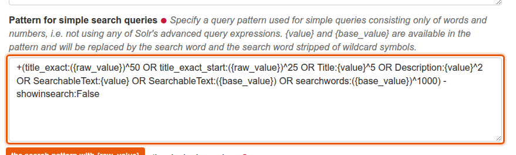

# Exact search with Solr

Version 1.1 (28.09.2026), changes in [CHANGELOG.md](CHANGELOG.md)

Plone's search through `collective.solr` splits every search term into words.
A phrase like "I am a test" therefore also matches pages that only contain "test", and the page with exactly that title is not necessarily on top.
`graffiti.search` adds the placeholder `{raw_value}` to the search pattern of `collective.solr`: the search term as the user typed it.
Together with two anchored field types in the Solr schema, exact and near-exact matches on the title are weighted higher and appear first.

| Where | Content |
|---|---|
| [src/graffiti.search/README.md](../../../src/graffiti.search/README.md) | How the patch and the field types work, the search pattern, setting up Solr step by step |
| `src/graffiti.search/` | The patch for `mangleSearchableText`, applied when the ZCML of the package is loaded |
| `solr_config/plone/conf/schema.xml` | Field types `text_lr` and `text_l`, fields `title_exact` and `title_exact_start` |
| `buildout.d/zeo/solr.cfg` | Buildout part `solr`, copies `solr_config/` into the Solr instance |

## Result

- A search for a complete title finds that page first, also with special characters like `C++`.
- The beginning of a title is enough, the end may differ.
- A part of a title that does not start at its beginning gets no boost, the normal full text search still finds it.
- Case does not matter, typos are not corrected.

The search pattern is not part of the code.
It lives in the Solr control panel of the site, the [README of the package](../../../src/graffiti.search/README.md) has an example in section 4.



## Try it

You need Solr, which the full buildout sets up (part `solr`, Solr 8.11.1):

```shell
bin/buildout
bin/solr-instance fg
bin/instance fg
```

Then in the site:

1. Open the Solr control panel at `<site>/@@solr-controlpanel`, activate Solr and enter the search pattern from the README of the package.
2. Open `<site>/@@solr-maintenance`, clear the index and reindex.
3. Create two pages: one with the title "I am a test", one with another title whose text contains "test" several times.
4. Search for "I am a test": the first page comes first.
   Search for "am a test": the boost does not apply, the normal full text search still finds both pages.

After every change to `schema.xml`: restart Solr and reindex.
