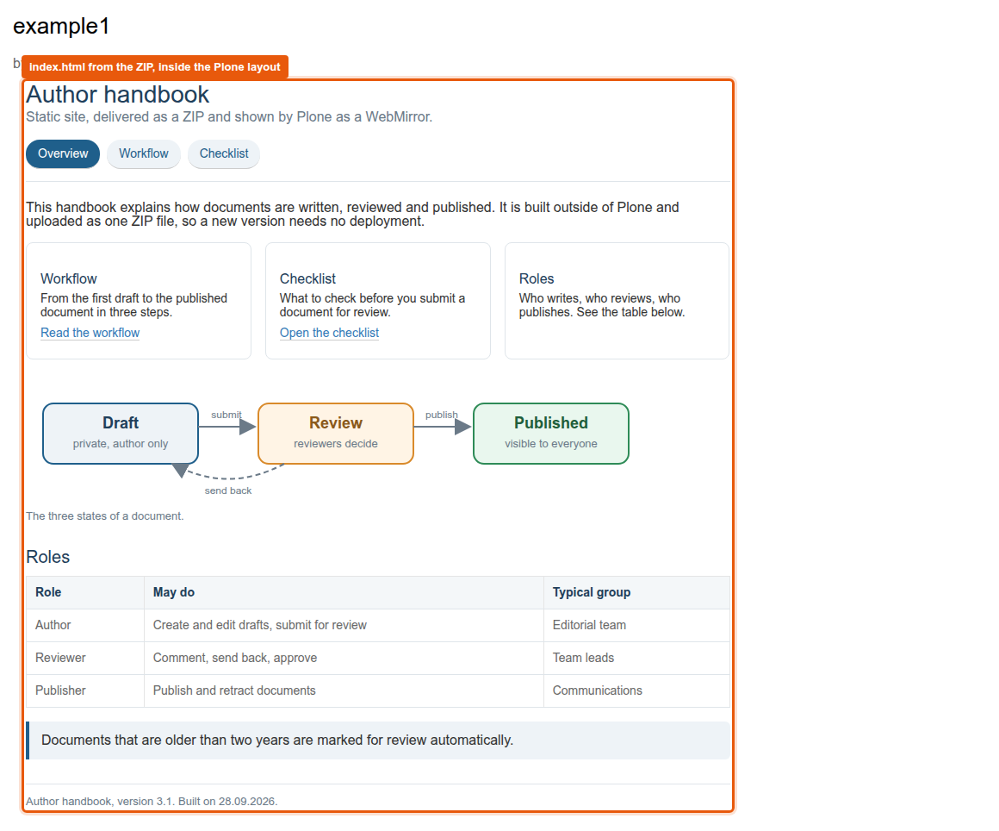
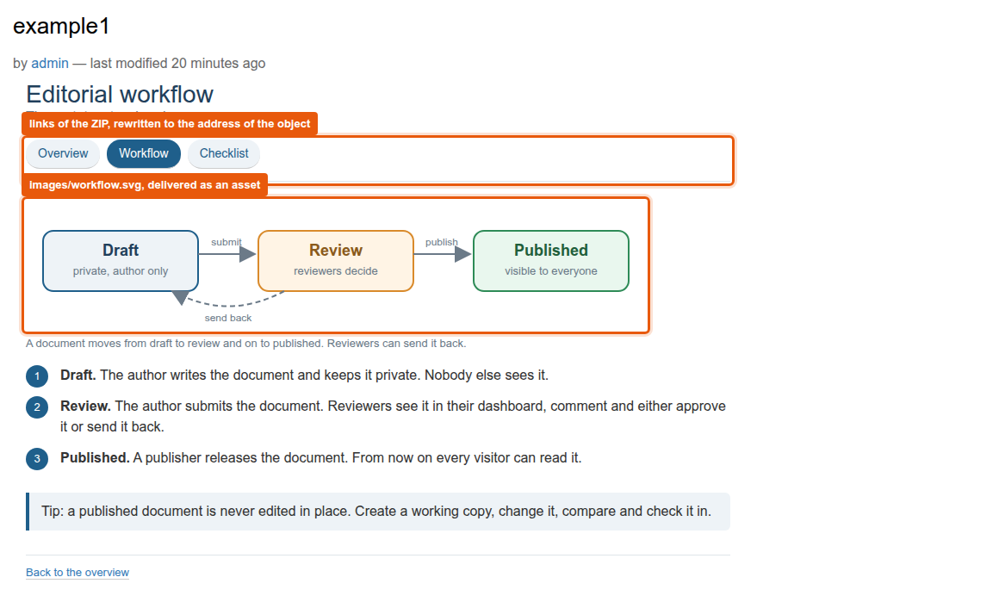

# WebMirror: deliver a static website as content

Version 1.2 (28.09.2026), changes in [CHANGELOG.md](CHANGELOG.md)

A WebMirror is a content object that carries a ZIP file with a static website: HTML pages, images, other files.
Plone shows the pages inside its own layout, under the address of the object.
Editors upload the ZIP like any other file, a new version of the website needs no deployment.

| Where | Content |
|---|---|
| `src/graffiti.contenttypes/src/graffiti/contenttypes/contenttypes/webmirror.py` | Type `WebMirror` with the fields `webmirror_id` and `zipfile`, unpacks the ZIP into the cache |
| `.../subscribers/webmirror.py` | Unpacks again when the object is created or changed |
| `.../traversal.py` | Catches paths below the object that Plone cannot resolve and hands them to the views |
| `.../views/webmirror.py` | `view` embeds the body of an HTML page into the Plone layout, `webmirror_asset` delivers images and other files |
| [WebMirror_example.zip](../../examples/WebMirror_example.zip) | Example "Author handbook": three pages with a navigation, two SVG diagrams under `images/`, styles inside the body |

## How it works

- The ZIP stays in the database as a blob.
  Every Plone host unpacks it into `$BUILDOUT_DIR/var/webmirrors/<webmirror_id>/` and delivers the files from its own disk.
  That is a cache per host: with several Plone hosts in front of one ZEO server, each host unpacks for itself.
  If the cache is missing, the object unpacks again on the next request.
- On the Plone host of the demo environment the supervisor program `cleanup-caches` empties the cache at start (`buildout.d/plone.cfg`).
- `<object>` shows `index.html`, `<object>/subsite.html` shows that page.
  The traverser puts the rest of the path into the request as `webmirror_path`, paths that contain `assets/` go to `webmirror_asset`.
- The view takes only the `<body>` of the page and rewrites links and `src` paths, so `./images/test.png` in the ZIP becomes `<object>/assets/images/test.png`.
  `webmirror_asset` checks that the requested file lies inside the cache folder of the object.

## Try it

1. In a folder choose Add, "WebMirror".
   Enter a WebMirror ID of letters and digits, for example `example1`, and upload [WebMirror_example.zip](../../examples/WebMirror_example.zip).
2. Open the object: the page from `index.html` appears inside the Plone layout, the diagram from `images/workflow.svg` is loaded.
3. Follow the navigation of the handbook or append `/workflow.html` to the address: the second page appears.
4. Upload another ZIP through Edit: the cache is unpacked again, the pages change at once.

## Limits

- Only the `<body>` of a page is shown, stylesheets and scripts referenced in the `<head>` of the page are not loaded.
  The example therefore carries its styles in a `<style>` block at the top of the body.
- Only files under `images/` are delivered as assets, the address `<object>/assets/...` maps to that folder.
- The title of the object is its WebMirror ID, it appears in navigation and breadcrumbs. The id in the address comes from Plone, for example `webmirror-1`.
- The ZIP is checked by its MIME type, not by its content.
