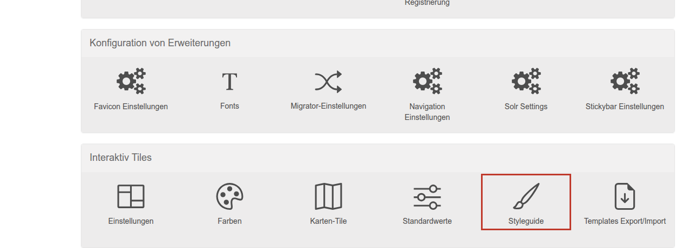
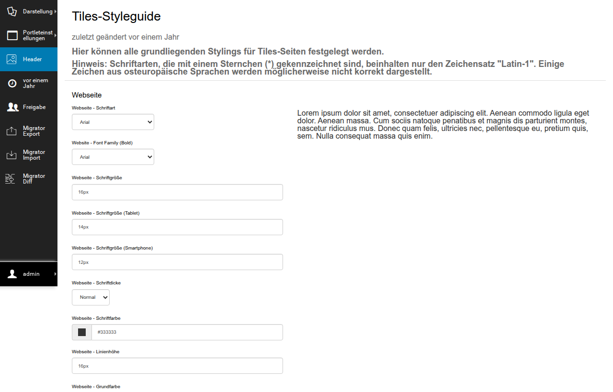

# CSS and JavaScript of the tiles: build and styleguide

This page explains how the styles and scripts of the tile packages get onto the page, what the control panel "Tiles-Styleguide" has to do with it, how the build works without internet access and what to check when styles are missing.
It applies to Plone 5.2 (`interaktiv.basetiles` v10) and Plone 6 (v29), the differences are in a table.

## From the source file to the page

Every tile package brings its styles as LESS and its scripts as plain JavaScript:

```
src/graffiti.tile_tabs/
├── package.json                                  registers the package with the build
└── src/graffiti/tile_tabs/static/
    ├── less/tile.less                            styles, all rules sit inside .tile-tabs (the class of the tile)
    └── js/tile.js                                script, written without a build tool
```

The build combines everything into three files that the theme loads on every page:

| Step | What happens | Result |
|---|---|---|
| 1. Merge the package list | `npm run preinstall` fetches the tool `package-json-interaktiv-merge` and merges all `src/*/package.json` into the `package.json` of the buildout root. Afterwards `interaktiv_setup.packages` lists every package whose files are built | `package.json` (root) |
| 2. Fetch the tools | `npm install` downloads Grunt and the LESS tools | `node_modules/` |
| 3. Write the styleguide | The values of the control panel "Tiles-Styleguide" are written to a file as LESS variables | `var/_styleguide.less` |
| 4. Grunt | All LESS files of the packages from step 1 plus those of the theme package become one CSS file, all JavaScript files become one script file | `var/static/css/style.css`, `var/static/js/script.js`, `var/static/js/libs.js` |
| 5. Deliver | The theme (`interaktiv.theme`) loads the three files through the view `@@static-files?file=...`, which reads them straight from disk | `<site>/@@static-files?file=style.css` |

Where Grunt writes is defined in the `Gruntfile.js` of the project (`paths['var']`).
Where the theme loads from is in its HTML files (`<link rel="stylesheet" href="...">`).

Three rules follow from this, and they are the ones broken most often in practice:

- **The packages must be checkouts under `src/`.**
  Grunt reads LESS and JavaScript from `src/<package>/src/<path>/static/`.
  A package that is only installed as an egg has no files there, its styles are missing from the build without any error message.
- **The packages must be listed in `interaktiv_setup.packages` of the root `package.json`.**
  The merge in step 1 adds them, but only if it runs.
  If it fails, you can also add the names by hand.
- **After every change to LESS or JavaScript, Grunt has to run.**
  The instance does not read source files, it only delivers the built files.

## Plone 5 and Plone 6

| | Plone 5.2, `interaktiv.basetiles` v10 | Plone 6, `interaktiv.basetiles` v29 |
|---|---|---|
| Buildout parts | `update_styleguide` generates the script `bin/update_styleguide`, `update_styleguide_trigger` runs it on every buildout | `styleguide` (recipe `interaktiv.basetiles:default`) runs on every buildout |
| What the build does | `npm run preinstall`, `npm install`, write the styleguide file, Grunt | `npm install` (which runs the merge of the package list first, it is registered as the `preinstall` script), then per Plone site: align the styleguide values in the registry, write the styleguide file, Grunt |
| Where the styleguide values live | in the file `var/_styleguide.less` itself | in the Plone registry of the site, the file is only an intermediate result |
| Needs a database | no | yes, the recipe starts `bin/instance run` (with ZEO the `script-instance`). A standalone instance has to be stopped for that |
| Start by hand | `bin/update_styleguide` | `bin/buildout install styleguide`, or Grunt only: `node_modules/.bin/grunt` |
| Saving the control panel | writes the file and runs `bin/update_styleguide` completely, shows the output | writes registry and file and runs Grunt, without `npm install` |

In Graffiti both ways end in the same files under `var/static/`.
If you only changed a LESS file, `node_modules/.bin/grunt` is all you need on both versions.

## The tiles styleguide

The site setup has the control panel "Tiles-Styleguide" (`<site>/@@tiles-styleguide`, own permission `interaktiv.basetiles.manange.styleguide`).



Administrators maintain colors, fonts, spacing and sizes for headings, links, buttons, lists, tables and rules there.



Every value is a LESS variable, for example the color of the buttons.
Step 3 of the build writes them to `var/_styleguide.less`, and Grunt pulls this file in before all others.
Saving the control panel rebuilds the CSS right away, the message shows success or the output of Grunt.

What this means for the tile packages:

- A package can use the variables in its LESS, then it follows the styleguide of the site.
- The five placeholder tiles do not do that yet, they use a few fixed grey values (listed as a follow-up task in [../entry-pages/evaluation.md](../features/entry-pages/evaluation.md)).
- The theme sets headings inside `#content` to `1rem`.
  Foreign markup with `h1` to `h6` inside a tile therefore needs its own font sizes with `!important`, which is what the search tile does for its result list.
- The root font size has to match `@global-font-size`, because the packages convert their px values into `rem` with it.
  On Plone 5 `interaktiv.theme` 4.x leaves the root at 10px, the dialogs of the tiles editor then get 62.5% of their size.
  Graffiti sets the root in its theme package [graffiti.theme](../../src/graffiti.theme/README.md).
- A project adjusts styles without touching the packages: either in the theme package (`interaktiv_setup.theme_package`, whose `static/less/*.less` is part of the build) or with a CSS rule, as with the icon of the urgent dashboard boxes ([../entry-pages/interfaces.md](../features/entry-pages/interfaces.md)).

## Building without internet access

Two steps of the build need the network: merging the package list fetches its tool (`package-json-interaktiv-merge`) from code.interaktiv.de over `git+ssh`, and `npm install` downloads from the npm registry.
On a server without internet access `bin/update_styleguide` or the buildout recipe stops at this point, Grunt does not run, and the old `style.css` stays in place.
The tiles themselves keep working, because the Python side does not depend on it.
This is exactly what "new tile, but no styling" looks like.

Way 1, bring the finished files:

1. Build on a machine with internet access, for example with `bin/buildout` or `node_modules/.bin/grunt`.
2. Transfer `var/static/` with the folders `css/` and `js/` together with the code to the target system.
   They are plain files, the instance reads them on request.
3. Let the buildout on the target system skip the styleguide part, for example with `bin/buildout install instance` instead of the full run.

Saving the control panel "Tiles-Styleguide" on the target system triggers Grunt there.
With this way Grunt is missing, saving reports an error and changes nothing in the files.

Way 2, bring the tools:

1. Version the root `package.json` with the finished package list under `interaktiv_setup.packages`.
   Graffiti does it this way, so the merge is not needed offline.
2. Transfer `node_modules/` to the target system as well.
3. Run `node_modules/.bin/grunt` there, it works without the network.

With this way saving the control panel works too.

## When styles are missing

Check these points in this order and stop at the first hit.

1. Open `<site>/@@static-files?file=style.css` in the browser and search for a class of the package, for example `tile-tabs`.
   If it is missing, the CSS is not built, continue with step 2.
   If it is there, a cache in front delivers the old file or the theme overrides the rules, see below.
2. Run `grep <package> package.json` in the buildout root.
   If the package is missing, the merge of the package list did not run: run `npm run preinstall` or add the name to `interaktiv_setup.packages` by hand.
3. Check that the LESS file of the package exists under `src/<package>/src/<path>/static/less/`.
   If not, the package is not a checkout under `src/`, but only installed as an egg.
4. Start the build by hand (`bin/update_styleguide` or `node_modules/.bin/grunt`) and read the output.
   An error at `npm install` almost always means: no internet access, see above.
5. Compare the date of `var/static/css/style.css` with the date of the LESS sources.
   If the sources are newer, Grunt did not run since the last change.

If everything is built and the styling is still missing, the build is not the problem.
Then a proxy cache in front of the instance, an environment variable `BUILDOUT_DIR` that points to another directory (the view `@@static-files` reads `$BUILDOUT_DIR/var/static`), or theme rules with a higher specificity are the candidates.

For the five placeholder tiles a script walks through these points automatically: [Adopting the tiles in your project](../features/entry-pages/adoption.md).
