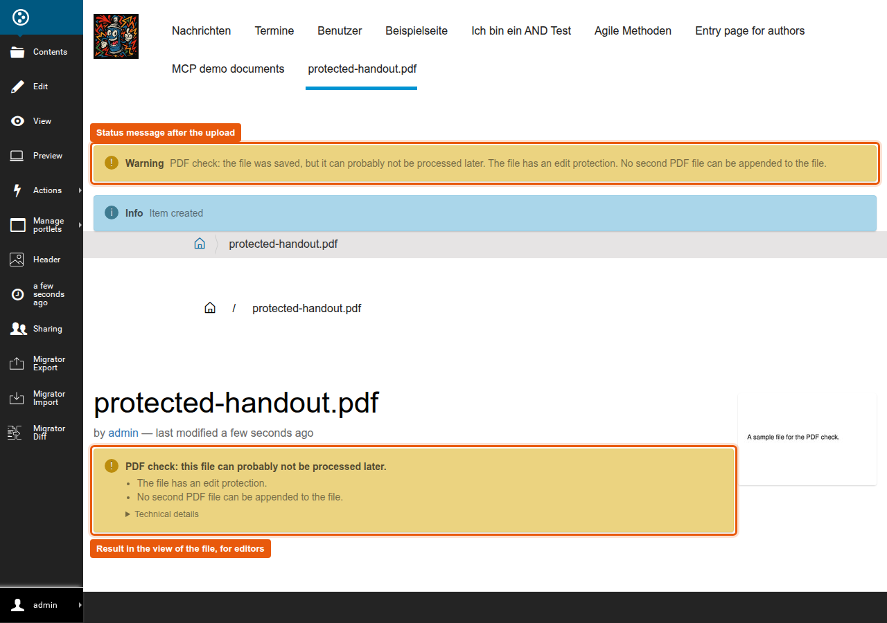
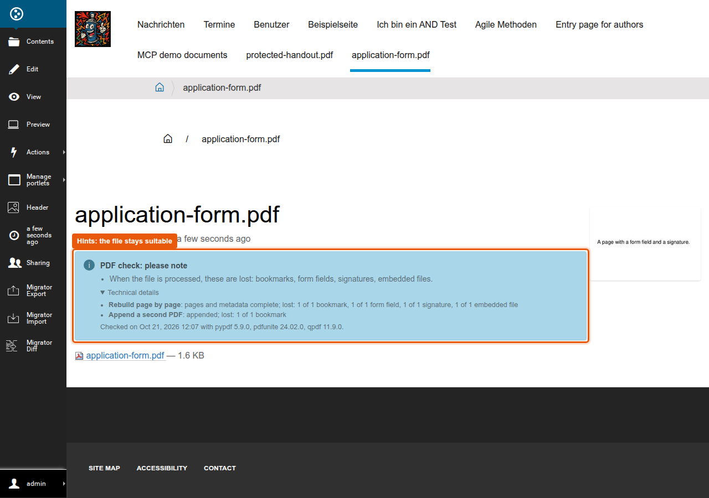
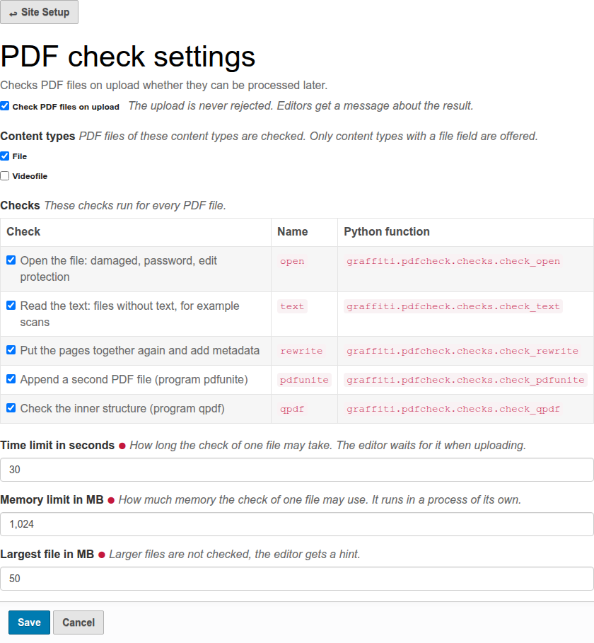

# graffiti.pdfcheck

Checks PDF files on upload whether they can be processed later, for example by a program that rebuilds them page by page, adds metadata or appends a second PDF.
The upload is never rejected: the file is saved, the editor gets a message, and the result is stored at the object, so that a workflow can ask for it.

The check covers the content type File of Plone.
Other content types are checked as well if they keep the PDF file in a field named `file`, they are chosen in the settings.
Files in fields with other names, for example in a list of attachments, are not checked.
The package runs on Plone 5.2 (Python 3.8) and Plone 6.1 (Python 3.11).

## What editors see

After the upload of a file with findings, a warning tells the editor why the file can probably not be processed later.
In the view of the file, users who may change it see the result as long as the file stays the same:



Hints do not make a file unsuitable.
They tell the editor what a later processing loses, for example bookmarks or form fields.
Without findings, the box is a note instead of a warning:



Messages and labels are in English and German, findings and hints are whole sentences.
What the programs say is under "Technical details", which is closed at first, and stays in English.
The box keeps beside a floating preview image of the file (`browser/static/pdfcheck.css`).

## The checks

| Step | Tool | What happens | Finding, if | Hint, if |
|---|---|---|---|---|
| `header` | script | reads the first 1024 bytes | | |
| `size` | script | compares the size with the limit | | larger than the limit (`not_checked`), nothing else runs |
| `open` | pypdf | opens the file | damaged (`damaged`), a password is needed (`password`), edit protection, so encrypted but opens without a password (`edit_protection`) | |
| `text` | pypdf | reads the text of all pages | no text, for example a scan (`no_text`) | |
| `rewrite` | pypdf | rebuilds the file page by page (`add_page`), adds metadata (`add_metadata`), reads the result again | this fails, or pages or metadata are lost (`rewrite`) | bookmarks, form fields, signatures or embedded files are lost (`lost_outlines`, `lost_form_fields`, `lost_signatures`, `lost_embedded_files`) |
| `pdfunite` | pdfunite (Poppler) | appends a blank page | pdfunite fails or leaves out pages (`pdfunite`) | as for `rewrite` |
| `qpdf` | qpdf | `qpdf --check` reads the whole structure | errors, exit code 2 (`qpdf`) | warnings, exit code 3: problems that qpdf can repair (`qpdf_warnings`) |

A file that does not start with `%PDF-` is no PDF: it stays untouched, no result is stored.

More findings:

* `crypto_missing`: the file is encrypted with AES, and the Python package `cryptography` is missing to read it. This is not a damaged file, but an incomplete check. Install it with the extra `graffiti.pdfcheck[crypto]`.
* `timeout` and `memory`: the check needed more time or more memory than allowed.
* `check_error`: the check process stopped before it checked anything.

"No text" means: fewer than `MIN_CHARACTERS` characters in the whole file, without spaces and line breaks.
It is 1, so a single readable character is enough, and a file that is only partly scanned passes.
The threshold is kept simple on purpose until it has been tried with real files.

Hints only name what the original file has: a file without bookmarks never gets `lost_outlines`.
pypdf loses all four when it rebuilds a file page by page, pdfunite of Poppler 24.02 loses the bookmarks.
A signature is never valid any more after one of these steps, even when the signature field is kept.

If pdfunite or qpdf is not installed, its step is skipped, this is no finding.
If pypdf can not open the file, `text` and `rewrite` are skipped.

`suitable` is `True` without findings, `False` with at least one finding, and `None` for files that were not checked: too large, the check could not run, or none of the checks could run, for example because pypdf can not open the file and the check `open` is switched off.
Such files get the hint `not_checked`.

## Settings

"PDF check settings" in the site setup, section add-on configuration (`@@pdfcheck-settings`):



| Registry record `graffiti.pdfcheck.` | Default | Meaning |
|---|---|---|
| `enabled` | on | check on upload; off also hides the result in the view, and removes the result of a file when the file changes |
| `portal_types` | `File` | content types whose field `file` is checked |
| `checks` | `open`, `text`, `rewrite`, `pdfunite`, `qpdf` | the checks that run, check boxes on the page with the name and the function of each check: the built-in checks and the registered checks of projects, see "Own checks of a project"; the page needs at least one, an empty list in the registry means all built-in checks |
| `timeout` | 30 seconds | the editor waits for the check during the upload |
| `memory_mb` | 1024 MB | memory of the check process |
| `max_size_mb` | 50 MB | larger files are not checked: hint `not_checked`, suitable is unknown |

The page only offers content types with a file field named `file`, in their schema or in one of their behaviors.
Other names in the registry, for example of a removed type or of a check that is no longer registered, do no harm: they are not shown and are dropped when the page is saved.
A project sets other values in the `registry.xml` of its own profile.

## When the check runs

The check runs when a file is added or changed: with the add and edit forms, the upload in the folder contents and in TinyMCE (both use `@@fileUpload`) and the REST API.
It only runs again when the file changed: edit forms and the REST API name the changed fields, otherwise the SHA-256 checksum of the file decides.
It also runs again for the same file when the last check could not finish: time or memory limit, an error of the check process, `cryptography` missing, or the hint `not_checked`.
Files larger than the limit are not read at all.
A copy keeps the result of its original.
If the check itself fails, for example because of a wrong setting, the file is saved with the hint `not_checked` and the error is in the log.

The REST API gets no status message, it would only show up on the next page.
After an upload in the folder contents, the message shows up on the next page as well.

The check runs while the editor waits, and while Plone adds the file.
For uploads with `@@fileUpload` Plone holds a lock for the whole instance, so a second upload of this kind waits until the check of the first file is done, at most for the time limit.
If Zope repeats a request because of a conflict, the check runs again.

## Using the result

The result is stored at the object as an annotation (`graffiti.pdfcheck`) and stays until the file changes.
There are three ways to use it.

### In Python code

For example in a view, an event handler or a script of a project:

```python
from graffiti.pdfcheck import api

api.is_suitable(obj)    # True, False or None
api.get_findings(obj)   # ['edit_protection', 'pdfunite']
api.get_hints(obj)      # ['lost_outlines']
api.get_result(obj)     # everything, see "The whole result" below
```

### In a workflow: stop a transition for unsuitable files

Example: a file with findings must not be published, the editor first uploads a better version.
A workflow does this with a guard expression at the transition, the expression asks the view `@@pdfcheck` of the file:

```
python: here.restrictedTraverse('@@pdfcheck').suitable() is not False
```

This stops files with findings and lets all others pass, also files that were not checked.
To stop files that were not checked as well, write `suitable() is True`.
To stop only files that pdfunite can not process, ask for one finding:

```
python: not here.restrictedTraverse('@@pdfcheck').has_finding('pdfunite')
```

The expression goes into the field "Expression" of the transition in the ZMI (`portal_workflow`), or into the `definition.xml` of the workflow in the profile of a project:

```xml
<transition transition_id="publish" ...>
  ...
  <guard>
    <guard-permission>Review portal content</guard-permission>
    <guard-expression>python: here.restrictedTraverse('@@pdfcheck').suitable() is not False</guard-expression>
  </guard>
</transition>
```

A stopped transition does not show up in the state menu, the box in the view of the file tells the editor why.
In Plone the content type File has no workflow by default, a project assigns one first (`workflows.xml` of its profile).

### From outside: the result as JSON

A program outside Plone, for example the one that processes the files later, gets the result at the address of the file plus `/@@pdfcheck`:

```shell
curl -u <user> https://www.example.org/site/folder/handout.pdf/@@pdfcheck
```

```json
{"suitable": false, "findings": ["edit_protection", "pdfunite"], "hints": [], "checked_at": "2026-10-21T10:10:56+00:00"}
```

Everyone who may see the file may get the result.
`suitable` is `null` and the lists are empty for files that were not checked.

### The whole result

Besides the result of the checks, the annotation has the checksum (`sha256`), the size, the filename and the field.
`api.get_result(obj)` returns it:

```python
{
    'is_pdf': True,
    'suitable': False,
    'findings': ['edit_protection', 'pdfunite'],
    'hints': [],
    'steps': {
        'header': {'state': 'ok', 'text': 'found', 'finding': None, 'hints': [], 'tool': 'script'},
        'open': {'state': 'finding', 'text': 'edit protection (...), 2 pages', 'finding': 'edit_protection',
                 'hints': [], 'tool': 'pypdf'},
        ...
    },
    'pages': 2,
    'versions': {'python': '3.8.20', 'pypdf': '5.9.0', 'pdfunite': '24.02.0', 'qpdf': '11.9.0'},
    'checked_at': '2026-10-20T08:15:00+00:00',
    'seconds': 0.42,
}
```

`state` is `ok`, `hint`, `finding` or `skipped`.
`graffiti.pdfcheck.checks.FINDINGS` and `HINTS` have an English text for each code, `graffiti.pdfcheck.messages` the translated labels.

## Checking files that were uploaded before

```shell
bin/instance run scripts/check_pdf_files.py --protocol https --host www.example.org --site_id site [--path /site/folder] [--force]
```

The script in the Graffiti repository checks all objects of the configured content types, also when the check on upload is switched off.
Unchanged files are skipped unless `--force` is given, for example after a change of the settings, files whose last check could not finish are checked again.
An object that can not be read, for example because its blob file is missing, is counted as an error, the run goes on.
It saves after every 50 checked files and prints one line per file.
Run it with a stopped instance, or on a ZEO client of its own.

| Option | Meaning |
|---|---|
| `--protocol`, `--host` | Required by `interaktiv.cronjob`, the base of the scripts that run as cron jobs: addresses in a script then look as seen from outside. This script only prints paths, give the address of the site. |
| `--site_id` | The id of the Plone site in the Zope root, default `site` |
| `--path` | Only files below this path, for example `/site/folder` |
| `--force` | Check unchanged files again |
| `--commit-every` | Save after this many checked files, default 50 |

## Own checks of a project

A project adds its own checks on top of the built-in ones.
A check is a function that gets a `Context` and returns a step:

```python
from graffiti.pdfcheck.checks import Check, finding, ok, skipped
from zope.i18nmessageid import MessageFactory

_ = MessageFactory('my.project')


def check_one_page(context):
    if context.reader() is None:
        return skipped('skipped, pypdf could not open the file')
    if context.pages > 1:
        return finding('too_many_pages', '%d pages, allowed is 1' % context.pages)
    return ok('1 page')


ONE_PAGE = Check(
    'one_page', 'pypdf', 'too_many_pages', check_one_page,
    title=_('Only one page per file'),
    texts={'too_many_pages': _('The file may only have one page.')},
)
```

| Value of `Check` | Meaning |
|---|---|
| `name` | the name of the check, also the name of its step in the result |
| `tool` | the tool it uses, stored with its step |
| `finding` | the code of the finding when the function fails with an error |
| `function` | the function of the check |
| `title` | the title on the settings page and in the technical details |
| `texts` | a sentence for editors for each code of a finding or hint of the check |

The function returns `finding(code, text)` for a finding, `ok(text)` or `ok(text, hints)` when the file passes, and `skipped(text)` when the check can not run.
`text` says in English what the check found, it shows up in the technical details.
For the code, editors see the sentence from `texts`, translated with the domain of the project.
Without a sentence they see the code itself.

The project registers the check in its `configure.zcml`, with the name of the check as the name of the utility:

```xml
<utility
    component=".pdfchecks.ONE_PAGE"
    provides="graffiti.pdfcheck.interfaces.IPdfCheck"
    name="one_page"
/>
```

Then the check shows up on the settings page as a check box, after the built-in checks, with its name and its function.
It runs when it is ticked there.
A project ticks it in the `registry.xml` of its own profile:

```xml
<record name="graffiti.pdfcheck.checks">
  <value purge="false">
    <element>one_page</element>
  </value>
</record>
```

The record exists only after `graffiti.pdfcheck` is installed, so the profile of the project depends on it (`<dependency>profile-graffiti.pdfcheck:default</dependency>` in its `metadata.xml`).

The checks of a project run after the built-in checks, in the order of their names.
They run in the check process, which has no Plone.
So the module of the check must not import Plone, small packages like `zope.i18nmessageid` are fine.
This also applies to the `__init__.py` files of its package, Python imports them first.
The function must be defined at the top level of the module, because the check process imports it by its dotted name.
If a ticked check is no longer registered, for example because its package was removed, it is left out and the log has a warning.

## Handing the check to an external service

The checks run through the utility `graffiti.pdfcheck.interfaces.IPdfCheckRunner`.
Its method `check(path, settings)` gets the path of the PDF file and the settings, and returns the result.
By default it starts the check process on the same host (`graffiti.pdfcheck.utilities.local_runner.LocalRunner`).

A project replaces it when another program shall check the files, for example a PDF service of the project on another server.
In this example the service answers with JSON like `{"pages": 3, "encrypted": true}`:

```python
import requests
from graffiti.pdfcheck.checks import add_step, finding, finish, new_result, ok
from graffiti.pdfcheck.interfaces import IPdfCheckRunner
from zope.interface import implementer

SERVICE = 'https://pdf-service.example.org/check'


@implementer(IPdfCheckRunner)
class ServiceRunner(object):
    """ Sends the file to the PDF service of the project instead of checking it on this host """

    def check(self, path, settings):
        with open(path, 'rb') as pdf_file:
            response = requests.post(SERVICE, files={'file': pdf_file}, timeout=settings['timeout'])
        response.raise_for_status()
        answer = response.json()
        # a result of the same form as the one of the built-in checks
        result = new_result()
        result['is_pdf'] = True
        result['pages'] = answer['pages']
        if answer['encrypted']:
            add_step(result, 'service', 'pdf-service', finding('password', 'the service can not open the file'))
        else:
            add_step(result, 'service', 'pdf-service', ok('%d pages' % answer['pages']))
        return finish(result)
```

In the `overrides.zcml` of the project it replaces the default:

```xml
<utility
    factory=".runner.ServiceRunner"
    provides="graffiti.pdfcheck.interfaces.IPdfCheckRunner"
/>
```

Everything else stays the same: the status message, the box in the view, the API and the workflow guard use the result as before.
Here the editor reads "The file is protected with a password.", the sentence of the built-in finding `password`.
If the service fails, for example because it can not be reached, the file is saved with the hint `not_checked` and the error is in the log.

`settings` has the keys `checks`, `timeout`, `memory_mb`, `max_size_mb` and `programs`.
`checks` are the names of the ticked checks, `graffiti.pdfcheck.settings.get_checks(names)` returns the checks for them.

## Own process and limits

The default runner starts `python -m graffiti.pdfcheck.checks` in its own process, with the Python and the import path of the instance.
On a server where `sys.executable` is no Python (for example under mod_wsgi or uWSGI), the environment variable `GRAFFITI_PDFCHECK_PYTHON` names the Python.
At the time limit the process and the programs it started are stopped.
The memory limit is set with `resource.setrlimit(RLIMIT_AS)` inside the process.
Starting the process takes about 0.4 seconds in a buildout of Plone 5.2.

The process is needed: rebuilding a large file with pypdf 5.9.0 can take minutes, crafted files can make pypdf run very long or use a lot of memory, and a deeply nested object makes Python 3.8 crash.
If the process stops during a check, the checks before keep their result, the running check gets the finding, the others are skipped.
If it stops before the first check, for example because the Python is wrong, the file gets the hint `not_checked`: that is a problem of the server, not of the file.

The process gets no input, and the runner reads only the lines of stdout that carry its marker, so output of a check of a project does no harm.

On the command line, the checks print the result as JSON:

```shell
bin/zopepy -m graffiti.pdfcheck.checks file.pdf [--checks open,text] [--program qpdf=/opt/qpdf/bin/qpdf]
```

`--checks` also takes the dotted name of a check of a project, for example `my.project.pdfchecks.ONE_PAGE`.

## Requirements on the server

* Poppler for pdfunite: `apt install poppler-utils`
* qpdf: `apt install qpdf`
* optional, for files encrypted with AES: the Python package `cryptography` (extra `graffiti.pdfcheck[crypto]`)

Without pdfunite or qpdf the check runs, the step of the missing program is skipped.

The check calls `pdfunite` and `qpdf` by their name, the server finds them on the `PATH`.
Programs in other places are set with the environment variables `GRAFFITI_PDFCHECK_PDFUNITE` and `GRAFFITI_PDFCHECK_QPDF`, in Graffiti in the settings of the buildout:

```ini
[settings]
environment-vars =
    GRAFFITI_PDFCHECK_QPDF /opt/qpdf/bin/qpdf
```

They are not part of the settings page on purpose: whoever may change the settings of the site must not be able to start any program on the server.

With interaktiv.basetiles before 17.0.1, damaged files and files with a password can not be uploaded at all, because the preview image fails.
In Graffiti the buildout of `main` has the package `graffiti.pdf_preview_fix` for this, interaktiv.basetiles 29 of the Plone 6 buildout has the fix.

## Versions

| Plone | Python | pypdf |
|---|---|---|
| 5.2.2 | 3.8 | 5.9.0, the last version for Python 3.8 |
| 6.1 | 3.11 | 6.x, 6.13 or newer recommended |

The results can differ: pypdf 6.13 and later repair a broken cross reference table, older versions report such a file as damaged.
Copying a page with a deeply nested object makes Python 3.8 crash, the check then reports the finding `rewrite`.

## Tests

```shell
bin/test -s graffiti.pdfcheck
```

The tests make small sample files in code, one for each finding and hint (`tests/samples.py`).
Only `tests/files/aes-128.pdf` is stored, because making it needs `cryptography`.
To look at the samples, for example to upload them in a Plone site:

```shell
bin/zopepy -m graffiti.pdfcheck.tests.samples /tmp/pdf-samples
```

In Graffiti, `scripts/setup_demo_pdf_check.py` puts them into the folder `/pdf-check-examples` of the site, each with a description.

The tests in `test_checks.py` and `test_runner.py` need no Plone, they also run with pytest.
`test_upload.py` uploads files through the add and edit forms, `@@fileUpload` and the REST API.
