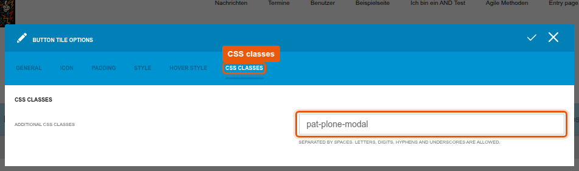
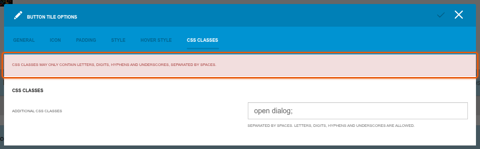
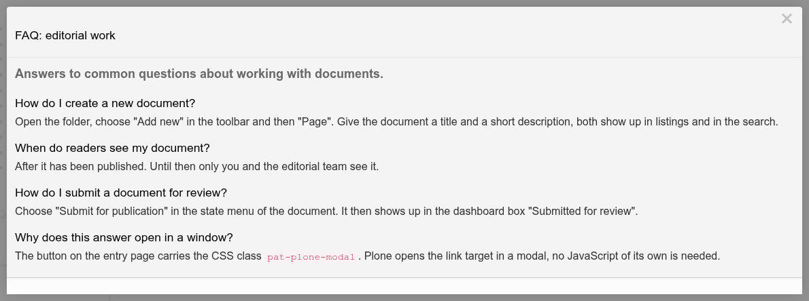

# graffiti.tile_button

Custom CSS classes for the button tile of `interaktiv.tile_button`.
Editors who may style the tile add their own classes to the button link, so that a project can attach behaviour to the button, for example opening a dialog.
The package changes the installed version of `interaktiv.tile_button` from the outside, the button tile itself stays as it is.

## What editors see

The dialog of the button tile gets a tab "CSS classes" with one field.
Several classes are separated by spaces, allowed are letters, digits, hyphens and underscores.
The field is saved together with the other settings of the button.



Other input is rejected when the dialog is saved:



The tab is only shown to users with the style permission of the tile (`InteraktivTiles: Style ButtonTile` or `InteraktivTiles: Style Tile`).
Users who may only change texts and links do not see it.

The classes are added to the link element next to `button`, in the view and in the tiles editor:

```html
<a class="button pat-plone-modal" href="https://example.org/entry-authors/faq-editorial-work">...</a>
```

## Attaching behaviour to a class

Without own JavaScript, Plone patterns work through classes.
With the class `pat-plone-modal`, the button opens its link target in a Plone modal instead of a new page.
The demo page "Entry page for authors" of Graffiti ends with a button "FAQ: editorial work" with this class, a click opens the FAQ of the folder in a modal (`scripts/setup_demo_entry_page.py`):



The same works with the add form of a folder: a link to `<folder>/++add++Document` opens the form for a new page in the modal, and saving it creates the page.

With own JavaScript, a project attaches its own behaviour to a class.
A delegated handler finds the button wherever it sits on the page, also after the tiles editor rendered the tile again:

```javascript
$(document).on('click', 'a.button.open-dialog', function (event) {
  event.preventDefault();
  openProjectDialog(this.href);
});
```

Keep a real link on the button, so that the click still leads somewhere useful without JavaScript.
The classes are also set in the tiles editor, a click on the button there triggers the behaviour as well.
A script that should only act in the view checks `document.body.classList.contains('edit-mode')`.
A typo in a class is not detected, the button then behaves like a normal link.

## Switching it off

The registry record `graffiti.tile_button.css_classes_enabled` switches the tab on and off, it is on after the installation.
Switched off, the tab is not shown, classes already set stay on the buttons.
A project switches it off in the `registry.xml` of its own profile:

```xml
<record name="graffiti.tile_button.css_classes_enabled">
    <value>False</value>
</record>
```

## How it works

| Part | Where | Kind |
|---|---|---|
| Field `button_css_classes` with the style permission | `behaviors.py`, added to the type `TileButtonCT` in `profiles/default/types/` | Behavior, the tiles editor saves and checks it like its own fields |
| Check of the input | `css_classes.py` | Field constraint |
| Classes on the link | `views/view.py`, `views/templates/view_<major version>.pt` | Override: copy of the template of `interaktiv.tile_button` |
| Tab in the dialog | `modals/button_dialog.py`, `modals/templates/css_classes_tab.pt` | Override: one more tab, its pane inserted before `</form>` of the rendered dialog |
| Readable message for invalid input | `static/js/button_dialog.js` | Addition: replaces the error type in the message of the dialog |
| Label of the tab | `locales/*/LC_MESSAGES/interaktiv.tile_button.po` | One message in the domain of `interaktiv.tile_button` |
| Switch | `interfaces.py`, `settings.py`, `profiles/default/registry.xml` | Registry record |

The views of this package are registered for the browser layer `IGraffitiTileButtonLayer`.
It extends the layer of `interaktiv.tile_button` and Plone's default layer, so the overrides win over the views of the button tile in every request.

## When interaktiv.tile_button is updated

The overrides depend on the installed version of `interaktiv.tile_button`.
Supported are 10.x (Plone 5.2) and 15.x (Plone 6.1).
After an update, run the tests of this package, they compare the overrides with the originals:

| Test | Fails when |
|---|---|
| `test_template_for_the_installed_version` | there is no copy of the template for the installed major version |
| `test_template_matches_the_original` | the template of the button tile changed |
| `test_tabs_match_the_original` | the tabs of the dialog changed |
| `test_field_inside_the_form` | the tab can no longer be inserted into the form of the dialog |

For a new major version, copy `views/templates/view.pt` of `interaktiv.tile_button` to `views/templates/view_<major version>.pt`, wrap the expression of the class attribute of the link in `view.get_button_classes(...)` and add the file to `TEMPLATES` in `views/view.py`.

`interaktiv.tile_button` 16.3.0 (Plone 6.2) brings the field `button_css_classes` itself, together with presets that editors choose in the dialog.
From that version on, this package is no longer needed.
Uninstall it before the update, the values stay in the tiles and the button tile uses them directly.
The switch of this package becomes the record `interaktiv.tile_button.css_classes_enabled` of the button tile.

## Installation

Install the add-on in the site setup of Plone, it installs `interaktiv.tile_button` if needed.
The JavaScript is part of the asset build of the project, see [assets-and-styleguide.md](../../docs/project/assets-and-styleguide.md).

## Tests

```shell
bin/test -s graffiti.tile_button
```
