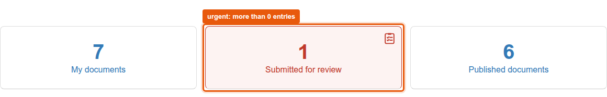
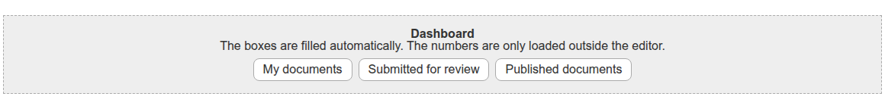

# graffiti.tile_dashboard

Placeholder tile for the Interaktiv Tiles Editor that renders dashboard boxes whose numbers are loaded by JavaScript.
Editors place the tile, which boxes it shows is decided in code through an adapter.
The tile is one of the five placeholder tiles for entry pages, the feature is described in [docs/entry-pages](../../docs/features/entry-pages/README.md).

## What editors see

In the tiles editor the tile is listed as "Dashboard".
Editors can place, move, style and delete it, there are no settings.
On the page every box shows a title, a description and a link.
The numbers are not part of the page, `static/js/tile.js` loads them after rendering from the view `@@tile_dashboard_data` of the tiles page, which answers with JSON for the logged-in user.
A box that declares itself urgent turns red and shows a task list icon as soon as its number is above zero.





## What decides the boxes

The view asks the adapter `IDashboardBoxesProvider` on (tiles page, request) for the boxes, the JSON view asks it for the numbers.
The default adapter `CollectionBoxesProvider` in `adapters/boxes.py` makes one box out of every collection in the folder the tiles page lives in.
The number of a box is the result count of its collection for the logged-in user, a collection tagged `todo` is an urgent box.

A project registers its own adapter for its browser layer and does not touch the views or templates.
The methods, keys, the flow in the browser and how to replace the icon are described in [interfaces.md](../../docs/features/entry-pages/interfaces.md#dashboard-idashboardboxesprovider).
The mixin `DashboardBoxesProviderContract` in `contract.py` checks a project adapter against the interface, see [contract tests](../../docs/features/entry-pages/interfaces.md#contract-tests).

## Package layout

| Path | Content |
|---|---|
| `contenttype.py`, `profiles/default/types/TileDashboard.xml` | Schema and type of the tile, `TileRowCT.xml` allows it in tile rows |
| `config.py` | Permissions `InteraktivTiles: Add, Delete, Move, Modify, Style DashboardTile` and the tile classes |
| `setuphandlers.py` | Registers the tile in the editor as `graffiti_tile_dashboard` |
| `interfaces.py` | Browser layer and `IDashboardBoxesProvider` |
| `adapters/boxes.py` | Default adapter |
| `views/view.py`, `views/templates/` | View `view_tile_tiledashboard`, one template for the page and one for the editor |
| `views/data.py` | View `@@tile_dashboard_data`, the numbers as JSON |
| `static/js/tile.js` | `initGraffitiTileDashboard`, called per tile by the editor, loads the numbers and sets the classes `tile-dashboard-loaded`, `tile-dashboard-failed` and `is-urgent` |
| `static/less/tile.less` | Styles, all rules inside `.tile-dashboard`. The icon of urgent boxes is the LESS variable `@tile-dashboard-todo-icon`, used as a mask on `.tile-dashboard-todo::before` |
| `contract.py` | Contract tests for project adapters |
| `locales/` | Translations, domain `graffiti.tile_dashboard` |
| `tests/` | Tests |

## Installation

Install the add-on in the site setup of Plone.
The demo script `scripts/setup_demo_entry_page.py` of Graffiti does that for all five placeholder tiles.
The package runs on Plone 5.2.2 and Plone 6.1.2, the requirements are listed in [interfaces.md](../../docs/features/entry-pages/interfaces.md#requirements).
Styles and the script are part of the asset build of the project, see [assets-and-styleguide.md](../../docs/project/assets-and-styleguide.md).

## Tests

```shell
bin/test -s graffiti.tile_dashboard
```
