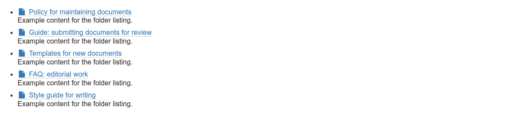
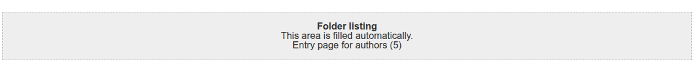

# graffiti.tile_listing

Placeholder tile for the Interaktiv Tiles Editor that renders a folder listing inside a tiles page.
Editors place the tile, what it lists is decided in code through an adapter.
The tile is one of the five placeholder tiles for entry pages, the feature is described in [docs/entry-pages](../../docs/features/entry-pages/README.md).

## What editors see

In the tiles editor the tile is listed as "Folder listing".
Editors can place, move, style and delete it, there are no settings.
In the editor the placeholder names what is listed, on the page the tile renders the entries with a CSS class per content type.





## What decides the content

The view asks the adapter `IListingItemsProvider` on (tiles page, request) for the entries.
The default adapter `FolderItemsProvider` in `adapters/items.py` lists the content of the folder the tiles page lives in, in folder order.
It leaves out the tiles page itself and content that is excluded from navigation.

A project registers its own adapter for its browser layer and does not touch the views or templates.
The methods, keys and rules of the interface are described in [interfaces.md](../../docs/features/entry-pages/interfaces.md#folder-listing-ilistingitemsprovider).
The mixin `ListingItemsProviderContract` in `contract.py` checks a project adapter against the interface, see [contract tests](../../docs/features/entry-pages/interfaces.md#contract-tests).

## Package layout

| Path | Content |
|---|---|
| `contenttype.py`, `profiles/default/types/TileListing.xml` | Schema and type of the tile, `TileRowCT.xml` allows it in tile rows |
| `config.py` | Permissions `InteraktivTiles: Add, Delete, Move, Modify, Style ListingTile` and the tile classes |
| `setuphandlers.py` | Registers the tile in the editor as `graffiti_tile_listing` |
| `interfaces.py` | Browser layer and `IListingItemsProvider` |
| `adapters/items.py` | Default adapter |
| `views/view.py`, `views/templates/` | View `view_tile_tilelisting`, one template for the page and one for the editor |
| `static/less/tile.less` | Styles, all rules inside `.tile-listing` |
| `contract.py` | Contract tests for project adapters |
| `locales/` | Translations, domain `graffiti.tile_listing` |
| `tests/` | Tests |

## Installation

Install the add-on in the site setup of Plone.
The demo script `scripts/setup_demo_entry_page.py` of Graffiti does that for all five placeholder tiles.
The package runs on Plone 5.2.2 and Plone 6.1.2, the requirements are listed in [interfaces.md](../../docs/features/entry-pages/interfaces.md#requirements).
Styles are part of the asset build of the project, see [assets-and-styleguide.md](../../docs/project/assets-and-styleguide.md).

## Tests

```shell
bin/test -s graffiti.tile_listing
```
