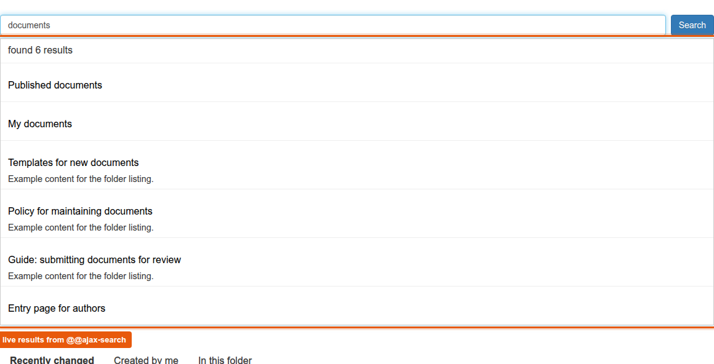
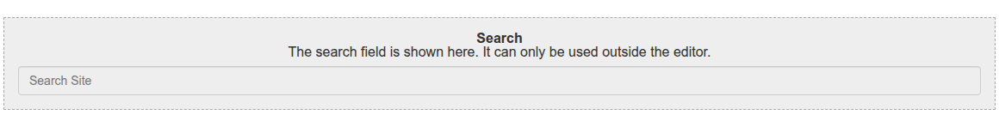

# graffiti.tile_search

Placeholder tile for the Interaktiv Tiles Editor that renders the site search with live results inside a tiles page.
Editors place the tile, where the search goes is decided in code through an adapter.
The tile is one of the five placeholder tiles for entry pages, the feature is described in [docs/entry-pages](../../docs/features/entry-pages/README.md).

## What editors see

In the tiles editor the tile is listed as "Search".
Editors can place, move, style and delete it, there are no settings.
On the page the tile renders a search form that submits with GET.
The live results reuse Plone's pattern `pat-livesearch`, the form only gets that pattern when the adapter delivers an address for the live results.
The tile can be placed several times on one page, the id of the input field is unique per tile.





## What decides the target

The view asks the adapter `ISearchTileSettings` on (tiles page, request) for the target of the form, the address of the live results, fixed extra parameters and the name of the search parameter.
The default adapter `SiteSearchSettings` in `adapters/settings.py` uses Plone's search page `@@search` and the live results `@@ajax-search` of the navigation root, without extra parameters, with the parameter name `SearchableText`.

A project registers its own adapter for its browser layer and does not touch the views or templates.
The methods and rules of the interface are described in [interfaces.md](../../docs/features/entry-pages/interfaces.md#search-isearchtilesettings).
The mixin `SearchTileSettingsContract` in `contract.py` checks a project adapter against the interface, see [contract tests](../../docs/features/entry-pages/interfaces.md#contract-tests).

## Package layout

| Path | Content |
|---|---|
| `contenttype.py`, `profiles/default/types/TileSearch.xml` | Schema and type of the tile, `TileRowCT.xml` allows it in tile rows |
| `config.py` | Permissions `InteraktivTiles: Add, Delete, Move, Modify, Style SearchTile` and the tile classes |
| `setuphandlers.py` | Registers the tile in the editor as `graffiti_tile_search` |
| `interfaces.py` | Browser layer and `ISearchTileSettings` |
| `adapters/settings.py` | Default adapter |
| `views/view.py`, `views/templates/` | View `view_tile_tilesearch`, one template for the page and one for the editor |
| `static/less/tile.less` | Styles, all rules inside `.tile-search`. The headings of the live results carry their own font size with `!important`, because the theme sets every heading inside `#content` to `1rem` |
| `contract.py` | Contract tests for project adapters |
| `locales/` | Translations, domain `graffiti.tile_search` |
| `tests/` | Tests |

## Installation

Install the add-on in the site setup of Plone.
The demo script `scripts/setup_demo_entry_page.py` of Graffiti does that for all five placeholder tiles.
The package runs on Plone 5.2.2 and Plone 6.1.2, the requirements are listed in [interfaces.md](../../docs/features/entry-pages/interfaces.md#requirements).
Styles are part of the asset build of the project, see [assets-and-styleguide.md](../../docs/project/assets-and-styleguide.md).

## Tests

```shell
bin/test -s graffiti.tile_search
```
