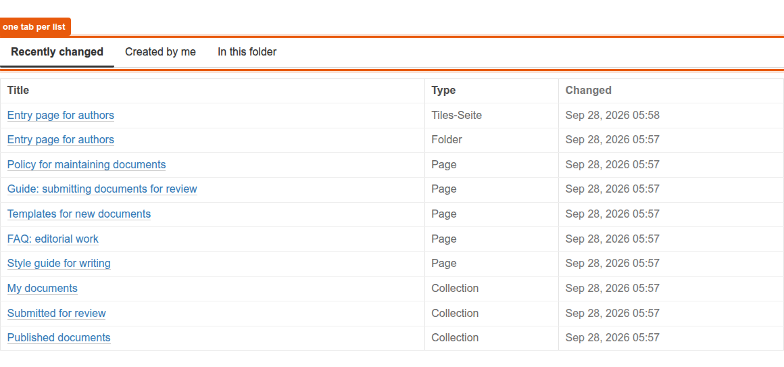
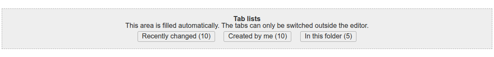

# graffiti.tile_tabs

Placeholder tile for the Interaktiv Tiles Editor that renders several lists under tabs inside a tiles page.
Editors place the tile, which tabs it shows is decided in code through an adapter.
The tile is one of the five placeholder tiles for entry pages, the feature is described in [docs/entry-pages](../../docs/features/entry-pages/README.md).

## What editors see

In the tiles editor the tile is listed as "Tab lists".
Editors can place, move, style and delete it, there are no settings.
On the page every tab is a table with its own columns, the first tab is open.
The tile renders everything on the server, `static/js/tile.js` only switches the tabs through one handler on the document, so a tile needs no initialization.





## What decides the tabs

The view asks the adapter `ITabListsProvider` on (tiles page, request) for the tabs.
The default adapter `DefaultTabsProvider` in `adapters/tabs.py` builds three tabs from the catalog: recently changed, created by me and the content of the folder the tiles page lives in.
Each tab has the columns title, type and changed and at most ten rows, the tab "Created by me" is empty for visitors.

A project registers its own adapter for its browser layer and does not touch the views or templates.
The methods, keys and rules of the interface are described in [interfaces.md](../../docs/features/entry-pages/interfaces.md#tab-lists-itablistsprovider).
The mixin `TabListsProviderContract` in `contract.py` checks a project adapter against the interface, see [contract tests](../../docs/features/entry-pages/interfaces.md#contract-tests).

## Package layout

| Path | Content |
|---|---|
| `contenttype.py`, `profiles/default/types/TileTabs.xml` | Schema and type of the tile, `TileRowCT.xml` allows it in tile rows |
| `config.py` | Permissions `InteraktivTiles: Add, Delete, Move, Modify, Style TabsTile` and the tile classes |
| `setuphandlers.py` | Registers the tile in the editor as `graffiti_tile_tabs` |
| `interfaces.py` | Browser layer and `ITabListsProvider` |
| `adapters/tabs.py` | Default adapter |
| `views/view.py`, `views/templates/` | View `view_tile_tiletabs`, one template for the page and one for the editor |
| `static/js/tile.js` | Switches the tabs, one delegated click handler for `.tile-tabs .tile-tabs-nav button` |
| `static/less/tile.less` | Styles, all rules inside `.tile-tabs` |
| `contract.py` | Contract tests for project adapters |
| `locales/` | Translations, domain `graffiti.tile_tabs` |
| `tests/` | Tests |

## Installation

Install the add-on in the site setup of Plone.
The demo script `scripts/setup_demo_entry_page.py` of Graffiti does that for all five placeholder tiles.
The package runs on Plone 5.2.2 and Plone 6.1.2, the requirements are listed in [interfaces.md](../../docs/features/entry-pages/interfaces.md#requirements).
Styles and the script are part of the asset build of the project, see [assets-and-styleguide.md](../../docs/project/assets-and-styleguide.md).

## Tests

```shell
bin/test -s graffiti.tile_tabs
```
