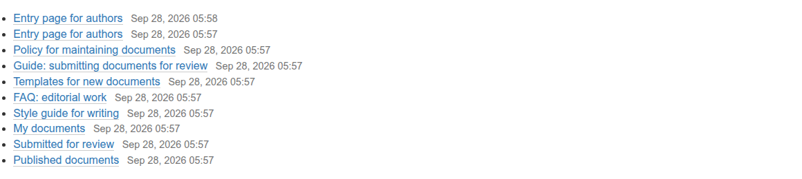
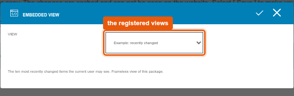
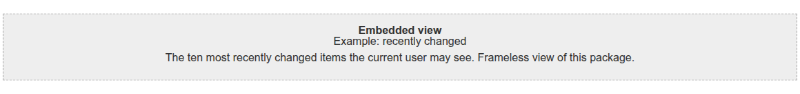

# graffiti.tile_view

Tile for the Interaktiv Tiles Editor that embeds a registered view into a tiles page.
A developer registers the views that may be embedded, editors pick one of them in the tile.
The tile is one of the five placeholder tiles for entry pages, the feature is described in [docs/entry-pages](../../docs/features/entry-pages/README.md).

## What editors see

In the tiles editor the tile is listed as "Embedded view".
Editors can place, move, style and delete it and open its settings (gear icon).
The settings dialog `configure_tileview_modal` lists the registered views with title and description, the tile stores only the id of the choice in its field `view_id`.
In the editor the placeholder shows title and description of the choice, the view is only rendered on the page.







## What decides the views

The view and the settings dialog ask the adapter `IEmbeddableViewsProvider` on (tiles page, request) for the list of views.
Every entry names an absolute address inside the site and a mode.
In mode `view` the address renders a frameless fragment that the tile inserts as it is.
In mode `ajax_load` the address is an ordinary page, the tile requests it with `ajax_load=1` and cuts out the content area.
Mode `ajax_load` is an interim solution for pages that have no frameless variant yet.

`embed.py` does the work: it fetches the address with `plone.subrequest` in the same request, so with the same user and permissions, and prepares the answer for the tile.
The default adapter `DefaultViewsProvider` in `adapters/provider.py` registers three examples: the frameless view `@@tile-view-example-recent` of this package in mode `view`, Plone's search page and sitemap in mode `ajax_load`.

A project registers its own adapter for its browser layer and does not touch the views or templates.
The keys, the two modes, their limits and the error cases are described in [interfaces.md](../../docs/features/entry-pages/interfaces.md#embedded-view-iembeddableviewsprovider).
The mixin `EmbeddableViewsContract` in `contract.py` checks a project adapter against the interface and renders every entry once, see [contract tests](../../docs/features/entry-pages/interfaces.md#contract-tests).

## Package layout

| Path | Content |
|---|---|
| `contenttype.py`, `profiles/default/types/TileView.xml` | Schema with the fields `title` and `view_id`, type of the tile, `TileRowCT.xml` allows it in tile rows |
| `config.py` | Permissions `InteraktivTiles: Add, Delete, Move, Modify, Style ViewTile` and the tile classes |
| `setuphandlers.py` | Registers the tile in the editor as `graffiti_tile_view` |
| `interfaces.py` | Browser layer, `IEmbeddableViewsProvider` and the two modes |
| `adapters/provider.py` | Default adapter with the three examples |
| `embed.py` | Renders an entry through `plone.subrequest`, cuts out the content area in mode `ajax_load` |
| `views/view.py`, `views/templates/` | View `view_tile_tileview`, one template for the page and one for the editor |
| `views/example.py` | The frameless example view `@@tile-view-example-recent` |
| `modals/` | The settings dialog `configure_tileview_modal` |
| `static/js/modal_configure.js` | `initializeConfigureTileViewModal`, submits the choice to the tiles page |
| `static/less/tile.less` | Styles, all rules inside `.tile-view` and `.configure_tileview_modal` |
| `contract.py` | Contract tests for project adapters |
| `locales/` | Translations, domain `graffiti.tile_view` |
| `tests/` | Tests |

## Installation

Install the add-on in the site setup of Plone.
The demo script `scripts/setup_demo_entry_page.py` of Graffiti does that for all five placeholder tiles.
The package runs on Plone 5.2.2 and Plone 6.1.2 and needs `plone.subrequest` and `lxml`, both part of Plone.
The other requirements are listed in [interfaces.md](../../docs/features/entry-pages/interfaces.md#requirements).
Styles and the script are part of the asset build of the project, see [assets-and-styleguide.md](../../docs/project/assets-and-styleguide.md).

## Tests

```shell
bin/test -s graffiti.tile_view
```
