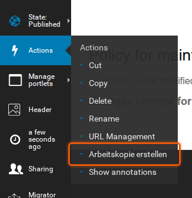
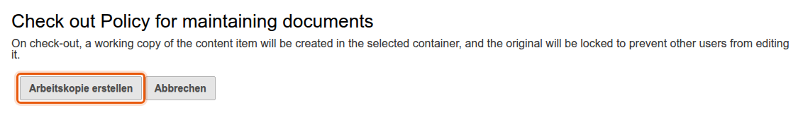
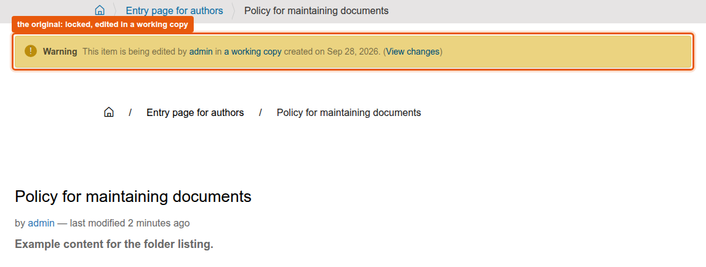
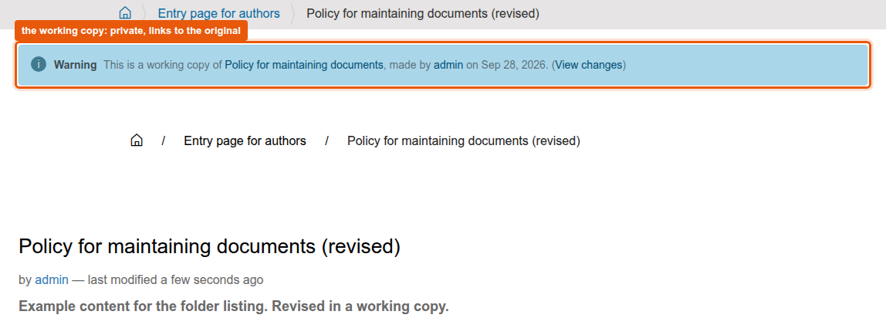
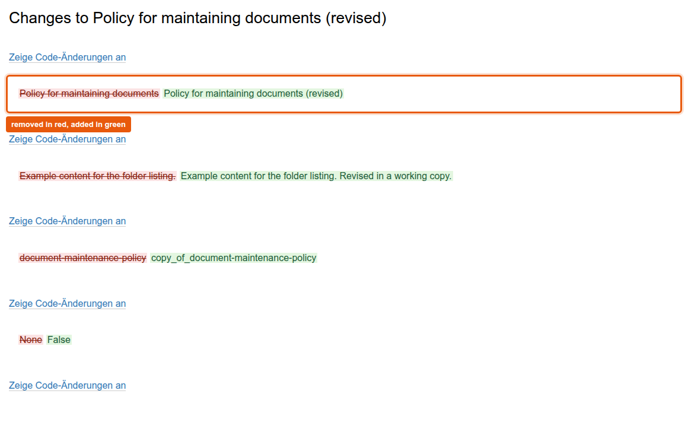
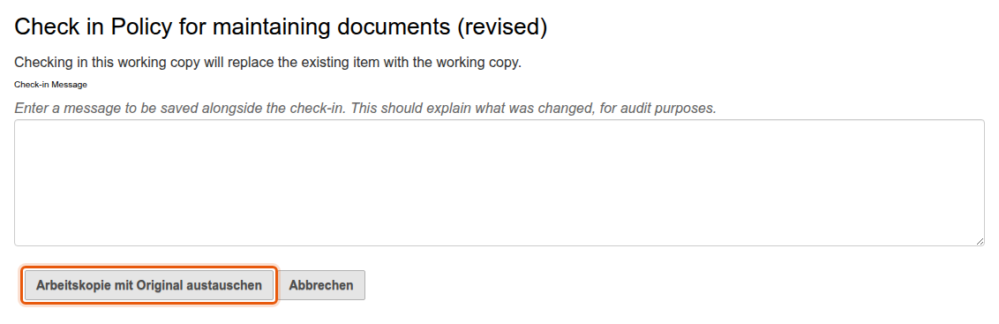

# interaktiv.workingcopy

Working copies for Dexterity content on the basis of `plone.app.iterate`.
An editor checks out a published page as a working copy, changes the copy while the original stays online, compares both, and checks the copy in.
The package adds what the standard lacks: a comparison view with colored changes, a lock on the original, information bars on both objects, clean deletion and events for own code.
The feature folder [docs/features/working-copies](../../docs/features/working-copies/README.md) only points here.

## What editors see

The checkout starts in the actions menu of the toolbar.



The checkout form explains what happens and creates the working copy in the same folder.



The original tells editors that it is being edited in a working copy and links to the changes.
Visitors see neither the bar nor the working copy.



The working copy names its original and links to the changes as well.



The comparison shows every changed field, removed text in red and added text in green.



Check in takes a message for the audit trail and replaces the original.
Cancel deletes the working copy instead.
Both unlock the original.



The labels of the actions and forms are German, the package brings no translations.
The names of the views are German as well and part of the address, they are kept for existing links.

## How it works

- Check out creates the working copy through `plone.app.iterate` and locks the original with a stealable lock.
- The comparison uses `portal_diff` of Plone and shows the changes field by field.
  `static/less/workingcopy.less` colors removed and added text.
- Deleting a working copy unlocks the original, an original with a working copy cannot be deleted.
- After check out, check in and cancel the package fires an event (`AfterCheckoutEvent`, `AfterCheckinEvent`, `AfterCancelEvent`) for own subscribers.
- The information bars are viewlets in the manager `plone.abovecontent`.
  The theme has to render that manager above the content, otherwise the bars stay invisible.

## Package layout

| Path (below `src/interaktiv/workingcopy/`) | Content |
|---|---|
| `behaviors/workingcopy.py` | Behavior `IWorkingcopyBehavior`, activates the feature for a content type. Adds the hidden fields `working_copy_version_notice` (change note of a checkout) and `working_copy_type` |
| `views/` | The four actions as views: `arbeitskopie-erstellen` (check out), `arbeitskopie-und-original-vergleichen` (compare), `arbeitskopie-mit-original-austauschen` (check in), `arbeitskopie-verwerfen` (cancel). `workingcopy_control` says which of them the current user may run |
| `viewlets/` | The information bars on the original and on the working copy |
| `subscribers/delete_workingcopy.py`, `views/actions.py` | Unlock on deletion, no deletion of a locked original |
| `events/` | The three events |
| `utilities/workingcopy.py` | `get_original()`, `get_working_copy()` and the relation between both |
| `profiles/default/actions.xml` | The three actions in the object buttons of Plone |
| `static/less/workingcopy.less` | Styles for the comparison view, part of the asset build (see [docs/project/assets-and-styleguide.md](../../docs/project/assets-and-styleguide.md)) |
| `tests/` | Tests for setup, checkout, locking, control view, utility and viewlets |

## Installation

1. Install the add-on in the site setup of Plone.
   In Graffiti `graffiti.policy` does that.
2. Activate the behavior `interaktiv.workingcopy.behaviors.workingcopy.IWorkingcopyBehavior` for the content types that should get working copies: site setup, "Dexterity content types", type, tab "Behaviors".
3. Make sure the theme renders the viewlet manager `plone.abovecontent`.
   In `interaktiv.theme` only the branches maintained for Graffiti do so: 4.5.x (Plone 5.2) from 4.5.6 on and 7.0.x (Plone 6.1.2) from 7.0.1 on.
   Take 4.5.7 or 7.0.2 and later, the versions before show the breadcrumbs of Plone a second time, also on tiles pages.
   The main line 8.x does not render the manager on purpose (8.0.1 did, 8.0.2 took it out again).
   With 8.x or with a theme HTML of your own, add an element with the ID `above-content` and drop `#viewlet-above-content #portal-breadcrumbs` in the rules, as the branch 4.5.x does.

The package is part of Graffiti on Plone 5.2 and on Plone 6.1.

## Tests

```shell
bin/test -s interaktiv.workingcopy
```
